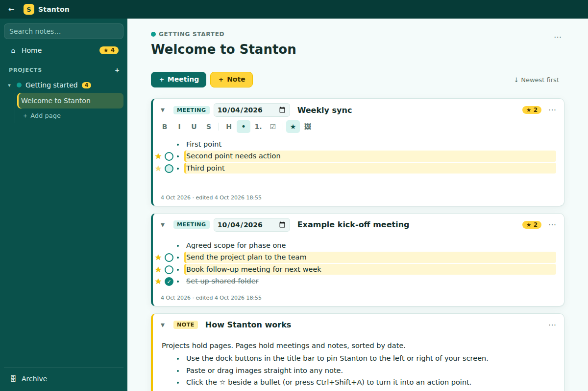
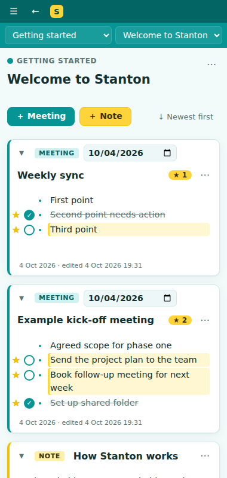

# Stanton

A lightweight meeting-notes app for Windows. It works like OneNote without the extra weight, and you can dock it to the side of your screen.

 

## Features

- **Projects → Pages → Meetings, Notes & Tasks.** A **Tasks** entry is a checklist; its header shows progress, e.g. ✓ 2/5. Use **Convert to** to turn a note's bullets into checkboxes.
- **Pages hold meetings, notes and task lists.** Each page lists its meetings and notes by date, newest or oldest first. A meeting's title has its date in front of it.
- **Action points.** Click the ☆ to the left of any bullet, or press `Ctrl+Shift+A`, to star it as an action point. The shortcut also works on a plain line, which becomes a starred bullet, and on several selected bullets at once. A **whole meeting or note** can be an action point too: click the ⚑ flag in its header, or press `Ctrl+Shift+A` in its title.
  - Open action points are pinned to the top of their **project**.
  - The **Home** page collects open action points from every project, grouped by project or as one list.
  - Tick the circle to mark an action point done (`Ctrl+Shift+D` inside the editor). It drops off the pinned lists but stays in the original meeting, struck through. "Recently completed" on Home lets you undo.
  - Click an action point to jump to the meeting it came from.
- **Rich notes.** Bold, italic, underline, headings, bullet and numbered lists, checklists and links. You can paste or drag in images and resize them. Pasted HTML from web pages and Office keeps its formatting.
- **Dock to the screen edge.** Use the ⇤ / ⇥ buttons in the title bar. On Windows, Stanton registers as a shell *AppBar* (the same mechanism the taskbar uses), so maximised windows fit beside it. Drag its inner edge to resize it. In the narrow docked layout, the project and page drop-downs and the ☰ drawer let you move between projects and pages.
- **Organise by drag and drop.** Drag projects up or down in the sidebar. Drag pages to reorder them, either in the sidebar or on the project page. To move a page to another project, drop it on that project; Stanton asks you to confirm first. The ⋯ and right-click menus also have Move up and Move down.
- **Right-click menus.** Right-click a project or page header, a sidebar row or a meeting/note header to get the same options as its ⋯ menu. In text, right-click gives Cut/Copy/Paste and spelling suggestions.
- **Pinned notes.** Pin any meeting or note from its ⋯ or right-click menu. It appears as a chip at the top of its own page and of the project page; click it to jump there. Right-click a chip to give it an emoji or unpin it.
- **Important dates** for each project (deadlines, launches, key meetings) appear above its action points. Home shows a **Coming up** list for the next three weeks, including today. Right-click a date and choose **Create meeting** to start notes for it.
- **Scratchpad** (under Home) for quick notes and meetings. File them later with the ⋯ / right-click menu → **Move to…**, which works on any meeting or note.
- **Home** can list projects as cards or as a compact list.
- **Backup & export.** Export everything (Settings) or a single project (its menu). There are three formats: a **Stanton backup** you can re-import, with images included; a **web page** to open in or paste into Word, OneNote or email; and **Markdown** for apps such as Obsidian or Notion. Importing a backup adds its projects alongside your existing ones.
- **Minimise to the system tray** (on by default; you can turn it off in Settings). While Stanton is hidden, its docked strip of screen is released for other windows.
- **Archive or delete** projects and pages from their ⋯ menus. Archived items are listed under **Archive**, where you can restore them.
- **Search** across page titles and note text (`Ctrl+F`).
- **Project colours.** Each project's colour is used for its pages: the card edges, the Meeting and Note buttons, bullets, tick circles and badges. Stars are always yellow. You can pick a preset or any custom colour.
- **Colour schemes:** Teal & yellow (#069494), Royal blue & orange-gold, or Graphite & amber. Each has light and dark modes, which follow Windows or can be set with the ◐ button or in **Settings**. Stars are always yellow.

## Data

Everything is stored locally under `%APPDATA%\Stanton\`. Diagnostics such as docking problems are written to `stanton.log` in the same folder.

The data folder `%APPDATA%\Stanton\data\` contains:

- `stanton.json` holds all projects, pages and entries. It is written atomically, and the previous version is kept as `stanton.json.bak`.
- `images\` holds pasted and inserted images.

### Moving to another PC without an export

Uninstalling Stanton does **not** delete your notes. They stay in `%APPDATA%\Stanton\data\`:

- `stanton.json`: all projects, pages, meetings, notes, dates and action points
- `stanton.json.bak`: the previous save, in case the main file is damaged
- `images\`: pasted and inserted images

**To replace everything on the new PC:** close Stanton there, then copy the whole `data` folder over its `%APPDATA%\Stanton\data`. When Stanton starts, it shows everything exactly as it was.

**To add the old notes alongside existing ones:** first copy the files from the old `images` folder into the new PC's `%APPDATA%\Stanton\data\images`. The file names are unique, so nothing is overwritten. Then go to Settings → Backup & export → **Import from a backup…** and pick the old `stanton.json`. Choose "All files" in the file picker if it isn't listed.

## Sync with Google Drive and the Android app

Stanton can keep its notes in a Google Drive folder. The PC and your phone then share the same notes.

**On the PC (no sign-in needed).** Install [Google Drive for desktop](https://www.google.com/drive/download/). It shows your Drive as a drive letter, e.g. `G:\My Drive`. In Stanton go to **Settings → Sync with Google Drive** and click **Use G:\My Drive\Stanton**, or choose another folder. Your existing notes are copied there and merged with anything already in the folder. Stanton watches the folder and merges changes from other devices within a few seconds. A safety copy is kept at `%APPDATA%\Stanton\data\sync-backup.json`. **Stop syncing** copies everything back to the PC.

**On Android.** Install `Stanton-x.y.z.apk` from the release (see below). Open **Settings**, check that the folder name matches the PC's folder inside My Drive (`Stanton` by default), and tap **Sign in with Google**. The phone keeps its own copy, so it works offline. It syncs when it opens, every minute while open, when you leave the app, and a few seconds after you edit. Tap the cloud icon in the title bar to sync now.

How changes are merged: every project, page and entry remembers when it was last changed. The newer version wins, deletions sync too, and edits to different entries on different devices are both kept. If the same entry is edited on both devices before they sync, the later edit wins.

### Installing the APK (sideloading)

1. On the phone, open the release page and download `Stanton-x.y.z.apk`.
2. Open it. Android asks you to allow your browser (or My Files) to **install unknown apps**: allow it, go back and tap **Install**.
3. Play Protect may warn about an unknown developer. Choose **More details → Install anyway**.

Updates install over the top and keep your notes, because every release is signed with the same key.

### One-time setup for Google sign-in (for whoever builds the releases)

The Android app asks Google for access to Drive. Google only allows this for apps registered in a Google Cloud project. It's free.

1. Go to <https://console.cloud.google.com/>, create a project (e.g. "Stanton"), then open **APIs & Services → Library**. Enable the **Google Drive API**.
2. Open **APIs & Services → OAuth consent screen** (Google Auth Platform):
   - Choose **External** and fill in the app name and your email.
   - Under **Data access**, add the scope `https://www.googleapis.com/auth/drive`.
   - Under **Audience**, click **Publish app** so it is *In production*. In *Testing* mode, sign-ins expire every 7 days. You don't need Google verification for personal use. Instead, the first sign-in shows "Google hasn't verified this app": choose **Advanced → Go to Stanton**.
3. Open **Clients → Create client → Android**:
   - Package name: `app.stanton.notes`
   - SHA-1: the release key's fingerprint, from `keytool -list -v -keystore stanton-release.jks`
   - No client ID or secret goes in the app. Google recognises it from the package name and signature.
4. In the GitHub repository, add two secrets under **Settings → Secrets and variables → Actions**:
   - `ANDROID_KEYSTORE_BASE64`: the keystore, base64-encoded (`base64 -w0 stanton-release.jks`)
   - `ANDROID_KEYSTORE_PASSWORD`: its password

   **Never commit the keystore, because this repository is public.** Keep a copy somewhere safe. A lost key means phones must uninstall and reinstall to update.

If sign-in fails with "error 10" (*DEVELOPER_ERROR*), the package name or SHA-1 in step 3 doesn't match the installed APK.

## Development

Requires Node.js 20+.

```bash
npm install
npm run dev        # Vite dev server + Electron with live reload of the UI
npm test           # unit tests
npm run typecheck
npm run build:android   # web build for Android + copy into android/ (then: cd android && ./gradlew assembleDebug)
```

Open `http://localhost:5173/?mobile=1` in a phone-sized browser window to preview the Android layout. The Android app is a [Capacitor](https://capacitorjs.com) shell (`android/`). Google sign-in is a small native plugin (`GoogleDrivePlugin.java`, using Google Play services). Drive is accessed through its REST API from `src/mobile/`.

## Releases

Push a version tag and GitHub Actions builds Stanton and publishes a GitHub Release with a Windows
installer, a portable `.exe`, a `.zip` and the signed Android `.apk`. The Android build needs the
two signing secrets described above.

```bash
npm version patch            # bumps package.json and creates a tag such as v0.1.1
git push --follow-tags
```

You can also run the **Release** workflow by hand from the Actions tab. With *publish* ticked, it creates the tag `v<package.json version>` and the release. Without it, the build is only uploaded as a workflow artifact.

## Building a Windows installer locally

Run this on Windows:

```bash
npm install
npm run dist       # → release/Stanton-Setup-x.y.z.exe, a portable .exe and a .zip
```

To cross-build from Linux or macOS, first install the Windows build of the FFI library that the dock uses:
`npm install --no-save --force @koromix/koffi-win32-x64`.

The dock uses [koffi](https://koffi.dev). Its JavaScript is bundled into `dist-electron/main.js`. Its native `koffi.node` is copied to `resources/koffi/win32_x64/` (see `extraResources`), where koffi looks for it through `process.resourcesPath`.

## Project layout

```
electron/        main process: window, storage and sync folder, image protocol, AppBar docking
  appbar.ts      SHAppBarMessage via koffi (falls back to edge-snapping elsewhere)
src/             React renderer
  editor/        TipTap editor + action-point extension (stars on list items)
  components/    Home, Project, Page, Archive views, sidebar, title bar, dialogs
  lib/           action-point extraction, persistence bridge, helpers
  mobile/        Android: Google Drive client, sync, back button and system bars
  store.ts       zustand store, debounced persistence and change stamping for sync
android/         Capacitor Android project (native Google sign-in plugin)
```

Action points are not stored separately. They are list items in an entry's document with `action` (`open` / `done`) and `actionId` attributes. The Home and project views derive their lists from those, so the pinned copies always match the meeting.
